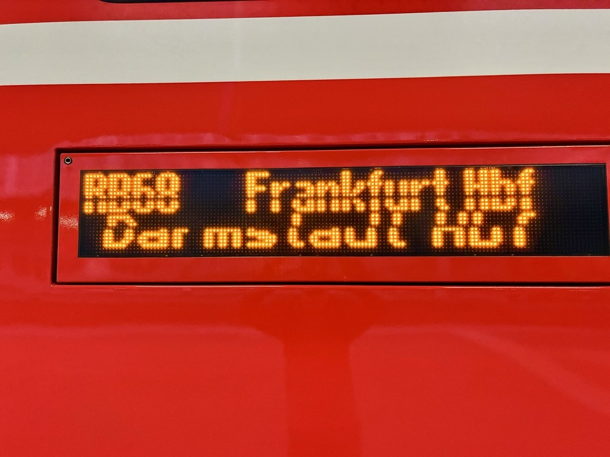
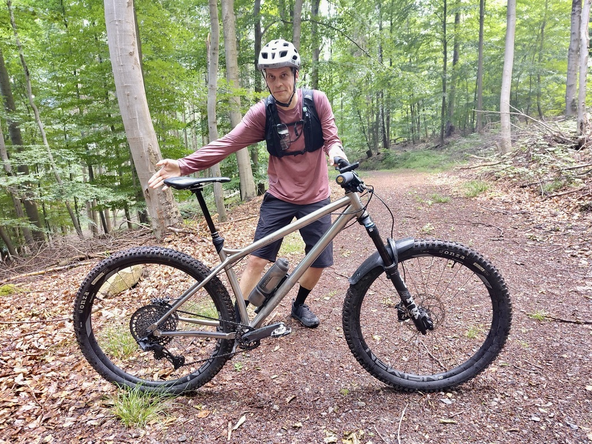
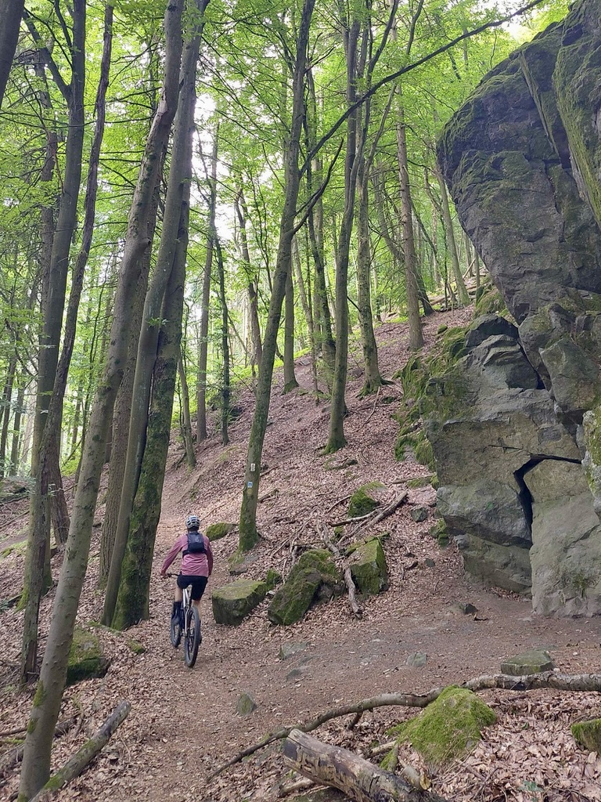
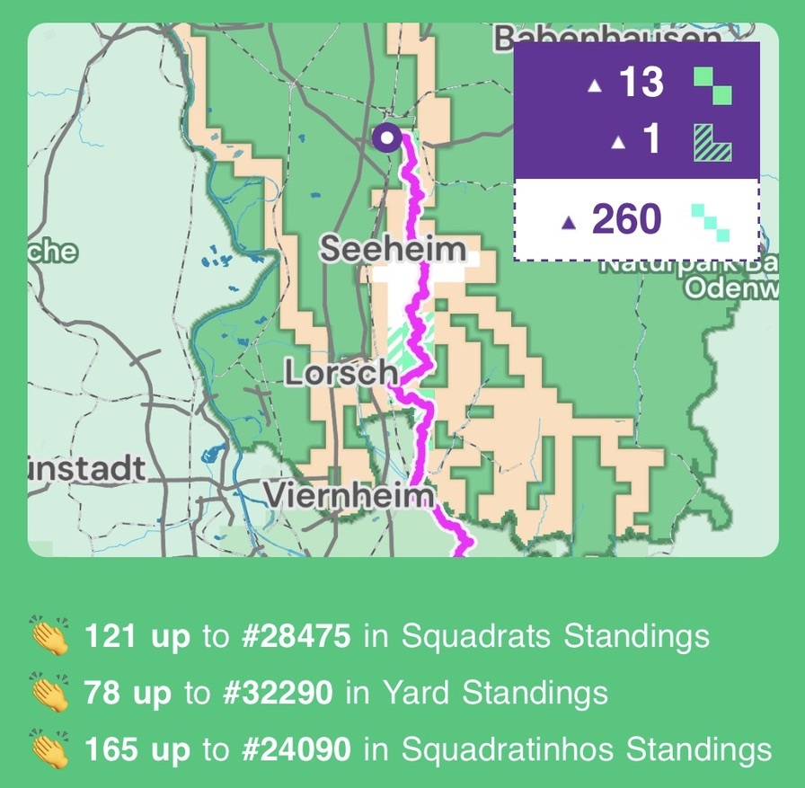
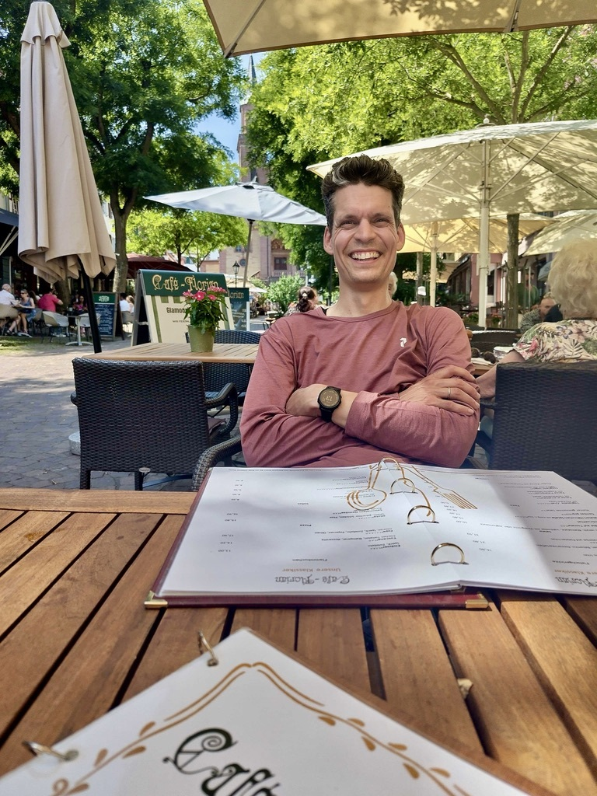
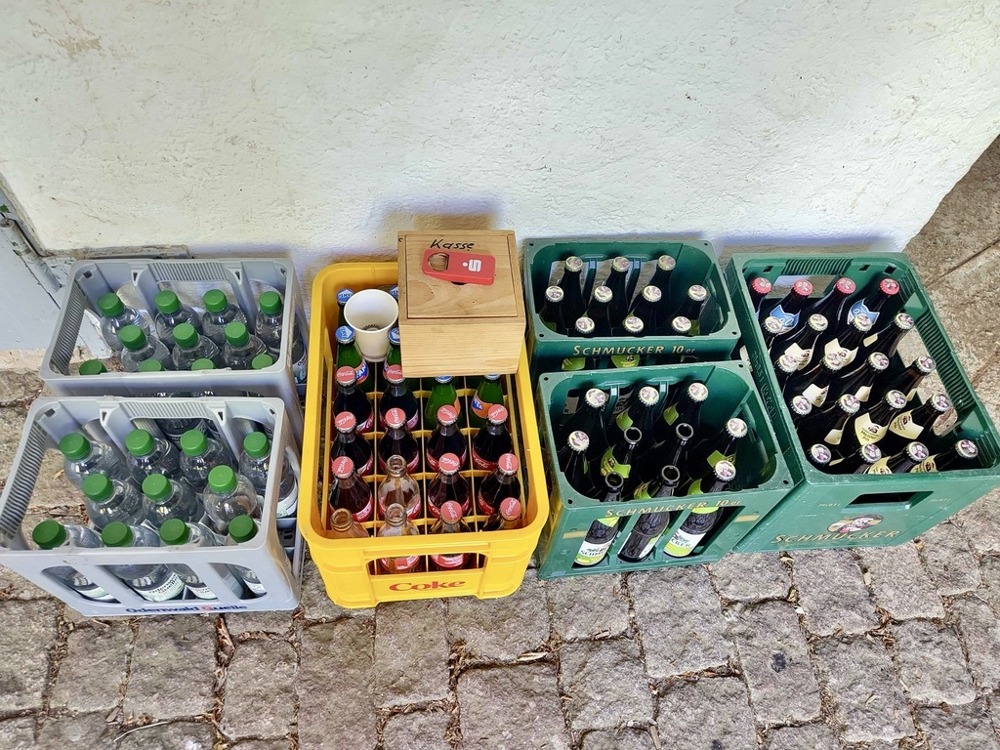
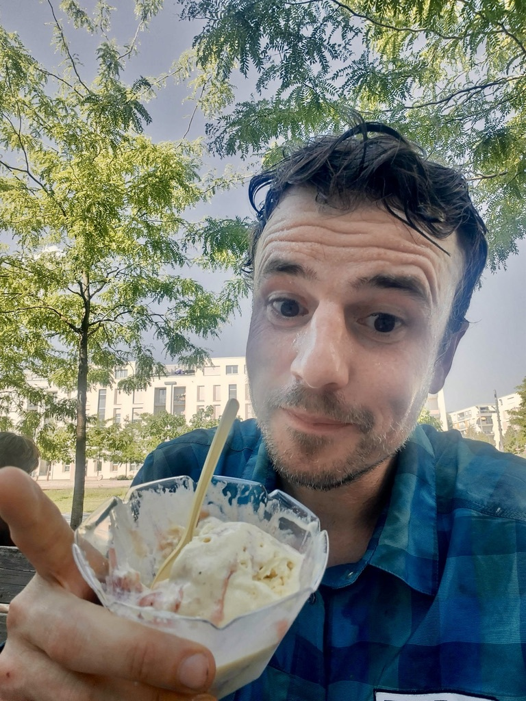
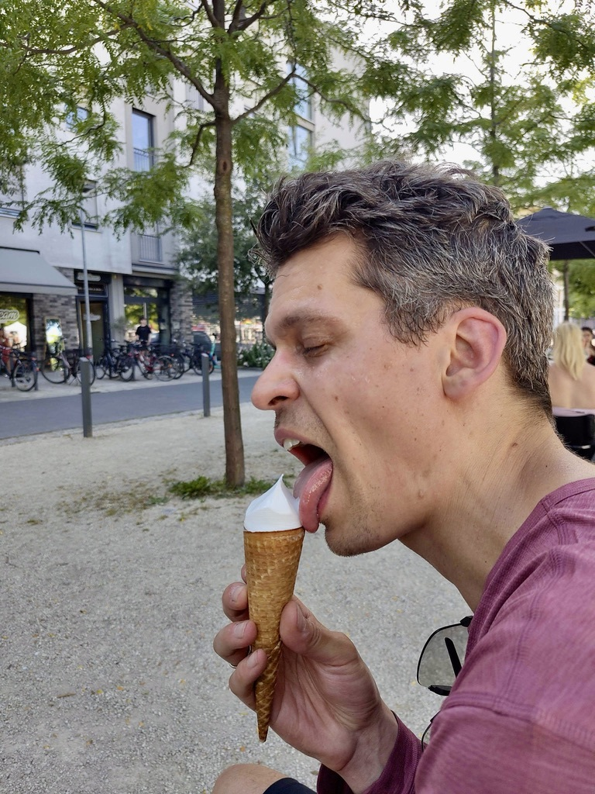

Beim #longestday, der Sommersonnenwende, gibt es traditionell zwei Varianten. Bei Variante eins steht bereits im Januar alles fest: Termin, Teilnehmer, Route, GPX-Track und vermutlich sogar die genaue Uhrzeit, zu der der erste Riegel aus der Trikottasche gezogen wird. Bei Variante zwei ist Anfang Juni, also zwei Wochen vorher, noch nicht einmal klar, wer überhaupt mitfährt. Geschweige denn, wohin.

Dieses Jahr wurde es Variante zwei. Also die ehrliche.

Felix hatte den Odenwald-Vogesen-Weg vorgeschlagen, musste krankheitsbedingt aber selbst passen. Seine Idee blieb trotzdem im Raum: von Darmstadt nach Heidelberg, immer dem roten Balken auf weißem Grund hinterher. Der Wanderweg führt eigentlich noch viel weiter, bis in die Vogesen. Wir wollten zunächst nur zurück nach Heidelberg. Das sollte reichen. Vorher wurde allerdings noch ausführlich diskutiert, ob wir tatsächlich in Darmstadt starten oder erst in Darmstadt-Eberstadt einsteigen. Argumente, Gegenargumente, Meinungswechsel. Am Ende siegte der Lehrbuchgedanke: Wenn schon roter Balken, dann von Anfang an. Also Darmstadt.

**5:20 Uhr, Heidelberger Hauptbahnhof.** Wir sind da, müde, aber offenbar ausreichend motiviert. Mark sorgt gleich auf der Treppe mit einer ordentlichen Bremsfanfare für Aufmerksamkeit. Damit dürften auch die letzten Schlafenden zwischen Gleis 1 und 10 wach gewesen sein. Attacke!

Im Zug dann das genaue Gegenteil. Eine ausgesprochen freundliche Zugbegleiterin versorgt uns mit Wettertipps und Lebensberatung. Es soll heiß werden, sehr heiß sogar. Mark nimmt die Information gelassen und erklärt, er werde heute vermutlich so viel Vitamin D sammeln, bis er explodiert. Zu diesem Zeitpunkt ist das noch ein Witz. Später bekommt die Aussage eine gewisse prognostische Qualität.

Mit an Bord ist außerdem eine Schulklasse auf dem Weg nach Berlin. Museumsbesuche, Besichtigungen, das übliche Programm. Ein Freibadbesuch gestaltet sich allerdings schwierig, weil nur ein Lehrkörper einen Schwimmschein besitzt. Zum Schwimmen braucht man offenbar zwei. Wir nehmen das zur Kenntnis. Ein Schwimmbad hätten wir später ebenfalls gern gehabt. Uns hätte allerdings schon eine ordentliche Menge kaltes Wasser gereicht.

**6:26 Uhr, Darmstadt.** Mark übernimmt zunächst die Stadtführung. Jugendstil, Stadion, Triathlon, Stadtfest mit Musik. Darmstadt hat einiges zu bieten. Sogar das Thema Hausverbot in einem Sushi-Restaurant wird kurz gestreift, bleibt aber leider nicht vollständig ausermittelt.

Dann endlich: Route.

  
  

Rückblickend war die Lehrbuchentscheidung goldrichtig. Der Abschnitt aus Darmstadt Richtung **Burg Frankenstein** ist nämlich richtig gut. Schmale Wege, Wald, angenehmes Hoch und Runter, immer wieder Trails, die sich handtuchbreit durch die Landschaft ziehen. Ein wunderbarer Einstieg. Und genau die Sorte Odenwald, für die man sich morgens um fünf freiwillig auf den Weg macht.

Unser eigentlicher Guide ist von Anfang an der rote Balken. Der GPS-Track hat stellenweise andere Vorstellungen, aber das interessiert uns wenig. Der Balken steht am Baum, weißer Grund, roter Strich. Keine Diskussion. Wenn das Garmin links sagt und der Balken geradeaus, fahren wir geradeaus.

**Es zählt nur, was am Baum steht.**

  

Bis Burg Frankenstein funktioniert das hervorragend. Und unmittelbar danach wird es sogar noch besser. Die ersten Trailpassagen hinter der Burg gehören zum Schönsten, was der Odenwald für solche Touren zu bieten hat. Schmal, verspielt, stellenweise ordentlich ruppig. Kein Bikepark, keine Waldautobahn. Einfach Trails, die Spaß machen. Es läuft.

  

Natürlich bleibt das nicht so. Irgendwann wird es steiler. Und alles, was steil und bergauf ist, ist bekanntlich dumm. Nicht moralisch, eher physikalisch. Das Vorderrad wird leicht, die Würde schwer und der rote Balken grinst irgendwo weiter oben am Baum. Dazwischen gibt es aber weiterhin schöne Gravelpassagen, Buchenwald und reichlich Schatten. Eigentlich eine ziemlich großartige Tour.

Wäre da nicht das Wetter.

Bis etwa elf Uhr bleibt es einigermaßen erträglich. Bewölkt, schwül, gelegentlich Regen. Nicht gerade kühl, aber immerhin noch kein Backofen. Danach wird es zunehmend unangenehm. Für den Tag sind bis zu **38 Grad** angekündigt, und Garmin meldet irgendwann Temperaturen, die wir lieber nicht gesehen hätten. Durchschnittlich 28 Grad, maximal 40 Grad am Gerät. Ob das der tatsächlichen Lufttemperatur entspricht, ist nebensächlich. Es ist jedenfalls viel zu warm.

Entsprechend viel wird getrunken. Trinkblasen, Flaschen, Wasser, Cola, alkoholfreies Weizen. Alles verschwindet in einem Tempo, bei dem man sich fragt, wo das Zeug eigentlich bleibt. Die spätere meteorologische Nachbesprechung lässt sich jedenfalls auf einen Satz reduzieren: „War aber echt zu warm!“

Die erste kleine Rettung wartet in **Heppenheim**. Ein Bäcker, Cola, Kohlenhydrate, ein paar Minuten Pause. Danach fühlt sich die Welt vorübergehend wieder in Ordnung an. Also weiter Richtung Weinheim. Wald, Höhenmeter, schöne Wege. Und wieder Höhenmeter.

Der Odenwald-Vogesen-Weg ist eben ein Wanderweg. Einer, der mit dem Mountainbike stellenweise hervorragend funktioniert und an anderen Stellen unmissverständlich daran erinnert, für wen er eigentlich gedacht ist. Es wird deshalb auch geschoben. Nicht dauernd, aber regelmäßig genug. Manchmal ist Radfahren beim Mountainbiken eben nur eine von mehreren Fortbewegungsarten.

Und wenn man zweifelt, hilft ein Blick an den nächsten Baum.

**Es zählt nur, was am Baum steht.**

In **Weinheim** kommt schließlich die große Pause. Im **Café Floh** gibt es Nudeln, Getränke und die Gelegenheit, die Kohlenhydratspeicher wieder aufzufüllen. Körperlich geht es eigentlich noch ganz gut. Mental sieht die Sache etwas anders aus. Wir sitzen, essen, trinken und wissen beide, dass wir gleich wieder aufstehen müssen. Und dass der anstrengende Teil des Tages vermutlich noch vor uns liegt.

  

Wie recht wir damit haben.

Der Abschnitt von Weinheim bis zum Weißen Stein lässt sich rückblickend relativ einfach zusammenfassen: **ein Arschloch.**

Es beginnt im **Exotenwald**. Ein Name, der nach botanischer Bildung, gemütlichen Wegen und angenehmem Schatten klingt. Tatsächlich geht es vor allem bergauf. Immer bergauf. Zumindest fühlt es sich so an. Hinter jedem Wegknick hofft man, dass es nun endlich etwas flacher wird. Stattdessen geht es einfach weiter nach oben. Irgendwann kommt auch noch der **Eichelberg** dazu. Und die Hitze. Und die Frage, warum wir nicht doch in Eberstadt gestartet sind. Hätte zwar am grundsätzlichen Problem nichts geändert, wäre aber immerhin ein paar Kilometer weniger gewesen.

Mittlerweile ist alles warm. Die Getränke, die Luft, vermutlich auch die Gedanken. Wir kommen zwar weiter, aber die Freude am Bergauffahren hält sich in engen Grenzen. Gerade Christian nähert sich irgendwann dem Punkt, an dem die Motivation ziemlich vollständig aufgebraucht ist.

Zum Glück gibt es an der **Mannheimer Hütte** eine unerwartete Bewirtung. Ohne die wäre Christian vermutlich einfach dort sitzen geblieben. Ein bisschen Zuckerwasser später sieht die Welt zumindest wieder so weit in Ordnung aus, dass wir den Weg zum **Weißen Stein** fortsetzen können.

  

Fahren, schieben, trinken. Wieder fahren. Hauptsache weiter.

Irgendwann ist der Weiße Stein erreicht und damit auch die Hoffnung, dass die schlimmsten Höhenmeter hinter uns liegen. Der GPS-Track schlägt nun vor, Richtung **Dossenheim** abzufahren. Nach diesem Tag klingt das ausgesprochen vernünftig. Runter ist schließlich fast immer eine gute Idee.

Aber da ist wieder dieser rote Balken.

Der möchte nämlich überhaupt nicht runter. Der bleibt oben auf dem Höhenzug und führt weiter Richtung Heidelberg. Und nachdem wir uns morgens für die Lehrbuchvariante entschieden haben, wäre es jetzt auch reichlich inkonsequent, plötzlich auf das Garmin zu hören.

**Es zählt nur, was am Baum steht.**

Also bleiben wir oben. Weiter über den Höhenzug, Richtung **Thingstätte**. Noch einmal Wald, schöne Wege und Ausblicke. Langsam kommt dieses vertraute Heidelberg-Gefühl auf. Die Beine sind müde, die Trinkvorräte überschaubar, aber das Ziel rückt endlich näher. Und so ganz nebenbei bestätigt sich noch einmal, dass die schönere Strecke nicht immer die einfachere ist.

Erst über den **Philosophenweg** geht es schließlich hinunter in die Heidelberger Altstadt. Nach einem ganzen Tag im Wald ist das ein eigenartiger Wechsel. Plötzlich wieder Neckar, Häuser, Cafés, Kopfsteinpflaster und Menschen, die offenbar einen völlig normalen Sonntag verbringen. Wir rollen durch die Stadt und weiter in Richtung Bahnstadt.

Dort gibt es endlich die Kühlung, die wir uns schon seit Stunden wünschen. An der Eisdiele und den Wasserspielen bei den **Schwetzinger Terrassen** werden Arme und Beine ins kalte Wasser gehalten. Eine einfache, aber ausgesprochen wirkungsvolle Maßnahme. Dazu ein Eis. Mehr braucht es in diesem Moment wirklich nicht.

  
  

Der Tag endet also nicht mit einer großen Zieleinfahrt, sondern ziemlich unspektakulär zwischen Eis, Wasser und der Erkenntnis, dass es vielleicht doch ein bisschen zu warm für diese Unternehmung war.

**100,44 Kilometer, 2.588 Höhenmeter und 11:41 Stunden Gesamtzeit** stehen am Ende auf dem Garmin. Ein sehr langer Tag, großartige Trails, reichlich Schieberei und eine ordentliche Portion Hitze. Trotzdem eine Tour, die in Erinnerung bleibt. Vielleicht gerade deshalb.

Und Felix? Danke für den Routenvorschlag. Krank sein und trotzdem Schuld haben - auch das muss man erst einmal schaffen.

<iframe src="https://www.komoot.de/tour/3055380677/embed?share_token=aNzumS8OWksJEVyBXSI7692FQm4Fd9i16LkdG1IZ8HKO1FGM6o" width="100%" height="600" frameborder="0" scrolling="no"></iframe>

