Kochkäs. Eine scheinbar einfache Mission, an der wir inzwischen schon zweimal gescheitert sind. Erst hat uns das Café Bauer bei einem eigentlich ganz anderen Ausflug aus der Bahn geworfen. Dann hatten wir endlich einen Termin für die große Kochkäs-Mission gefunden, nur um festzustellen, dass das angepeilte Lokal ausgerechnet an diesem Tag geschlossen hat. Dieses Mal soll alles anders werden. Neuer Anlauf, neues Ziel: der Rebstock im Odenwald. Eine Empfehlung, die sich hartnäckig hält. Bei einem Geburtstag hatte ich kurz zuvor sogar eine 82-jährige Odenwälderin kennengelernt, die seit 30 Jahren im Rheinland leben, sich aber noch immer bestens an den Rebstock erinnern. Für die Wahl unseres Ziels werden wir von den Herrschaften praktisch zu ausgewiesenen Odenwald-Kennern erklärt. Na dann!

Sonntag ist geplant. Die Wettervorhersage ist allerdings beschissen. Also ziehen wir die Tour kurzerhand auf Samstag vor. Das kostet Teilnehmer, sodass am Ende nur noch Mark, Felix und ich übrig bleiben. Und weil das Wetter auch am Samstag nicht wirklich einladend aussieht, wird gleich die ganze Tour eingedampft. Mit der Bahn nach Hirschhorn, von dort durchs Gelände zum Rebstock und anschließend irgendwie nach Heppenheim zurück. So weit der Plan.

Samstag, 10:30 Uhr. Heidelberger Hauptbahnhof. Mark ist bereit. Für feuchte Wurzeln! Im Gegensatz zu Felix, der uns im Vorfeld nicht müde wurde, auf die Gefahren nasser Wurzeln, seine Fahrtechnik und die Unzulänglichkeiten seines Bikes hinzuweisen. Während wir noch auf Felix aus Richtung Frankfurt warten, hat Mark bereits Berliner zur Stärkung organisiert. Um 10:50 Uhr sitzen wir zu dritt im Zug nach Hirschhorn. Die Stimmung ist bestens. Mark verkündet vorsorglich: „Heute fahren wir kein Rad.“ Angesichts der Bodenverhältnisse wäre das vielleicht gar keine so schlechte Idee gewesen.

  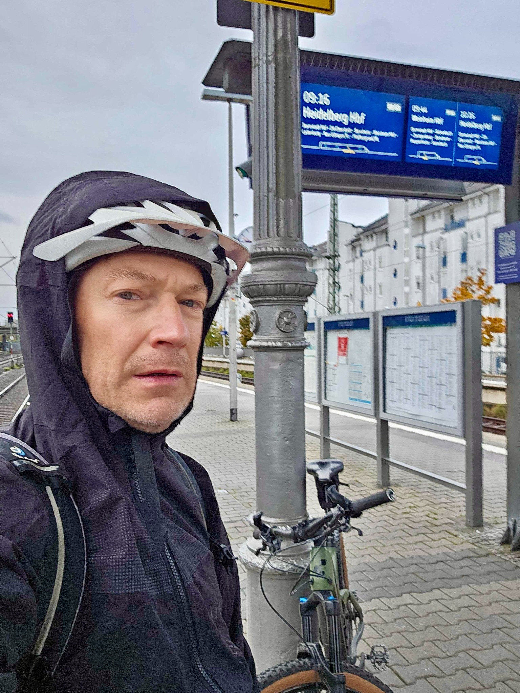
  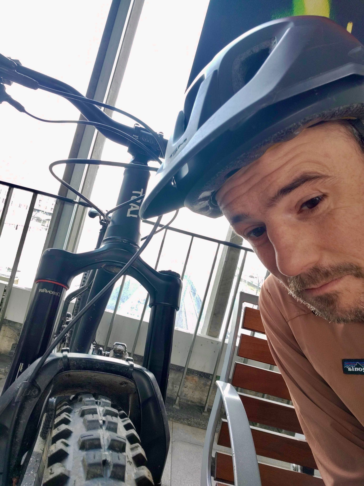
  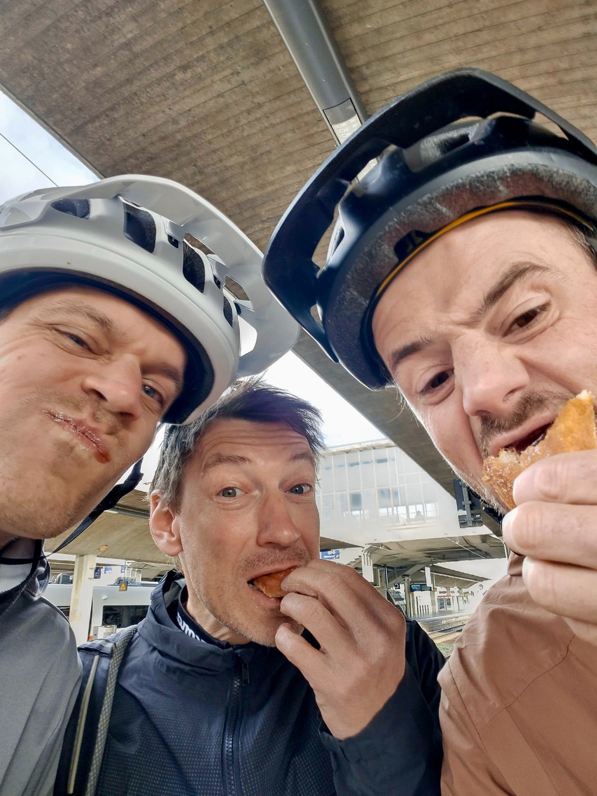

Gegen halb zwölf geht’s dann aber doch los. Mark hatte im Vorfeld noch bezweifelt, ob uns nördlich von Hirschhorn überhaupt irgendetwas Fahrenswertes erwarten würde. Weit gefehlt! Schon bald haben wir richtig schöne Trails unter den Stollen. Besonders das blaue Quadrat auf weißem Grund entpuppt sich als echter Glücksgriff. Abenteuerliche Wanderwege, wunderschöne Wälder und Naturschutzgebiete, ständig hoch und runter. Teilweise richtig episch! Das festigt die Idee, solche Wanderwege künftig einfach mal auf ihrer gesamten Länge zu erkunden. Wenn nur der Boden nicht wäre. Der Regen der vergangenen Tage hat ganze Arbeit geleistet. Alles ist aufgeweicht, schlammig und rutschig. Jeder Meter kostet gefühlt doppelt so viel Kraft.

Zwischendurch noch ein schönes Beispiel für gelebte Dorfkultur: Ein kleiner Dirtpark direkt am Sportplatz. Sieht ein bisschen so aus, als hätte die Dorfjugend einfach angefangen zu buddeln und irgendwann wäre das Ganze offiziell geworden. Inzwischen steht sogar „DORF-LOVE“ darüber. Herrlich! So geht Nachwuchsförderung.

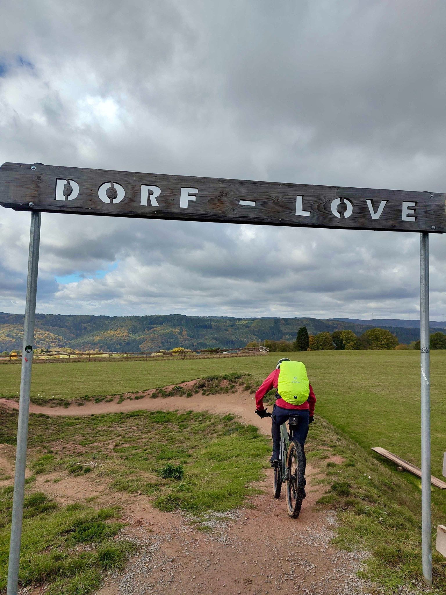

Gegen halb zwei ist die Hungergrenze längst überschritten. Seit geraumer Zeit vertrösten wir uns auf die nächste schöne Aussicht, um endlich Brotzeit zu machen. Blöd nur, dass wir zwar auf einem Höhenzug unterwegs sind, rechts und links aber konsequent Wald steht. Irgendwann reicht’s. Eine sonnige Wegkreuzung muss herhalten. Brotzeit! Immerhin ein bisschen Wärme. Und natürlich die nächste Diskussion über die richtige Kleidung. Zu warm, zu kalt, zu nass. Felix und ich haben gleich zwei Wechselsets eingepackt und können erstmals in trockene, etwas wärmere Klamotten schlüpfen. Mark hat nur eins dabei und muss haushalten. Dass ihm inzwischen ziemlich kalt ist, würde er vermutlich vehement bestreiten.

Felix hingegen hat neue Handschuhe. Und deren An- und Ausziehen entwickelt sich zusammen mit seinen ständigen Klamottenwechseln zu einem eigenen Programmpunkt. Das erinnert zunehmend an das Kindergeburtstags-Schokolade-Auspacken. Nur dass wir eigentlich noch ein bisschen Rad fahren wollten. Felix sieht das natürlich anders. Ihm sei den ganzen Tag über kontinuierlich angenehm warm gewesen. Kann nicht jeder behaupten, meint er später. Wo er recht hat, hat er recht. Zeit kostet das Ganze trotzdem!

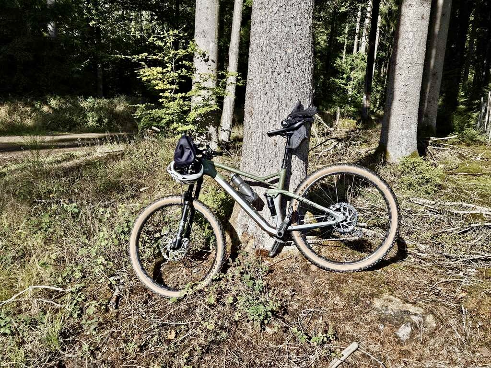

Weiter geht’s. Immerhin finden wir anschließend noch einen richtig schönen Trail. An dessen Ende werden wir dann beinahe vom örtlichen Förster samt Jeep umgenietet. Rechts vor links scheint im Wald eher als unverbindliche Empfehlung zu gelten. Vermutlich hatte er bei dem Sauwetter auch nicht unbedingt mit drei Mountainbikern gerechnet.

Eine weitere Überraschung wartet bei Hammelbach. Ein paar Motorräder zwischen Felsen und Baumstämmen wecken unsere Neugier. Also kurz links abbiegen und schauen, was da los ist. Tatsächlich sind wir mitten in die Deutsche Jugend-Trial-Meisterschaft geraten! Wir schauen eine Weile zu, wie die Nachwuchsfahrer ihre Motorräder mit unglaublicher Balance über Hindernisse zirkeln. Ziemlich beeindruckend, was die da veranstalten. Und wir machen uns Gedanken über nasse Wurzeln!

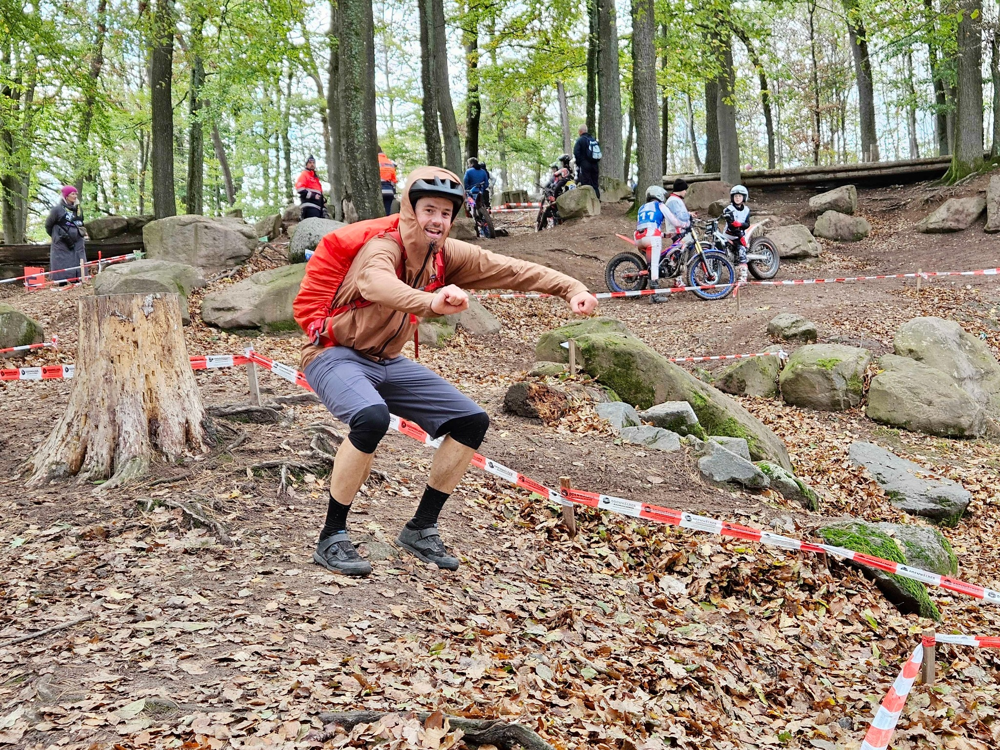

Irgendwann kommen wir auch wieder am Café Bauer vorbei. Genau dem Ort, an dem unsere erste Kochkäs-Mission ein unrühmliches Ende gefunden hatte. Diesmal halten wir lieber ausreichend Sicherheitsabstand. Bloß nicht wieder in Versuchung kommen! Eine kurze Pause auf der Wiese dahinter muss reichen. Dann weiter. Wir haben schließlich noch eine Mission zu erfüllen.

  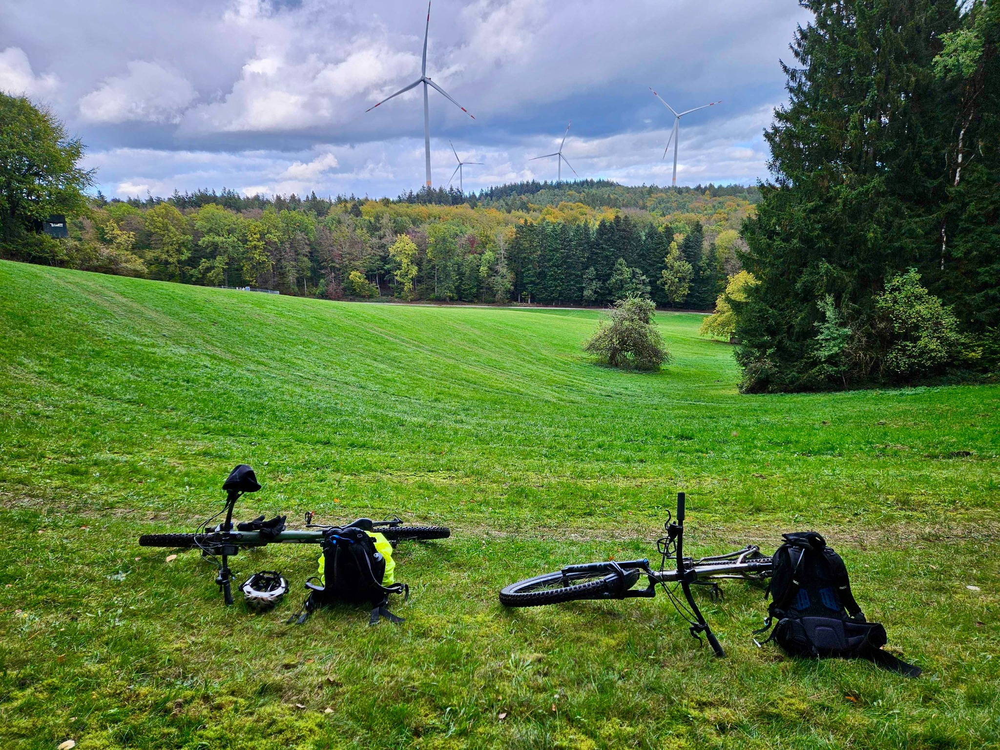
  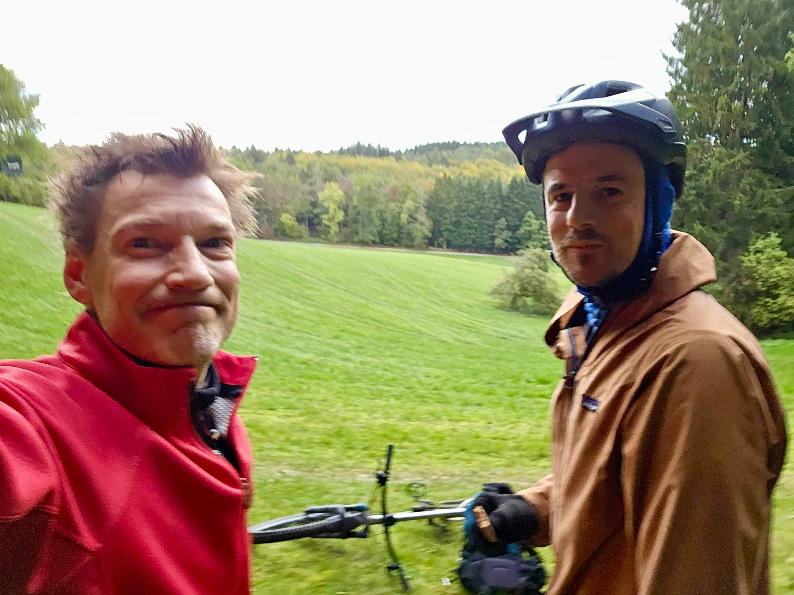

Auf den letzten Kilometern gibt’s sogar noch ein Wiedersehen mit der Fürth F1. Und siehe da: HDF war schon hier! Ein Heidelbergs-Finest-Aufkleber klebt seit gefühlten Ewigkeiten an der Streckenbeschilderung. Mittlerweile hat er es sogar auf diverse Komoot-Fotos geschafft. Nachhaltiges Marketing können wir!

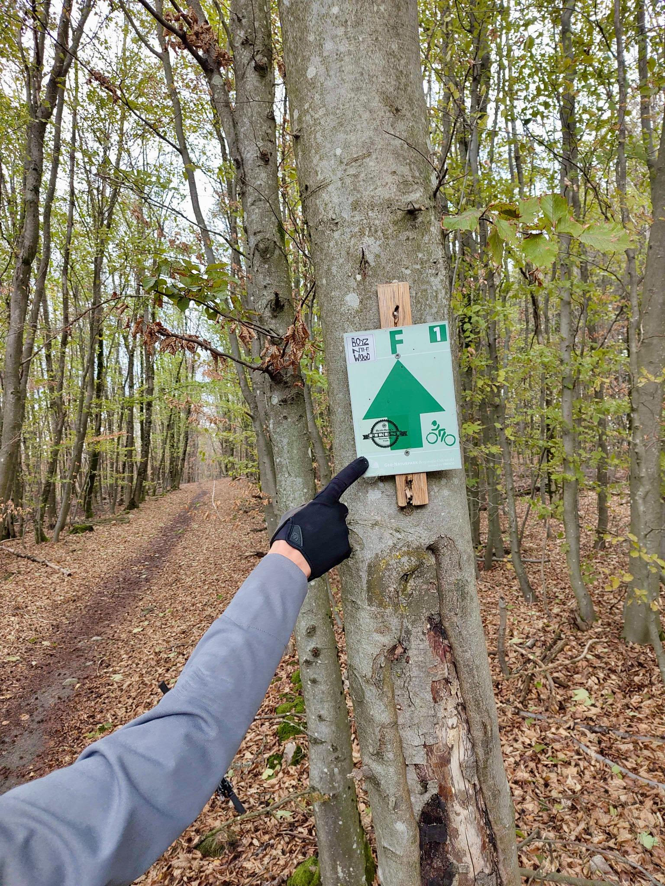

Punkt 16 Uhr. Rebstock! Wir haben es tatsächlich geschafft. Ziemlich paniert, ordentlich hungrig und nach zwei gescheiterten Anläufen endlich am Ziel. Drinnen scheint die Zeit irgendwann stehen geblieben zu sein. Herrlich! Reservierungen? Gibt’s nicht. Einfach vorbeikommen, Platz findet sich. Die Wirtin erklärt das in den ersten zehn Minuten gleich mehrfach am Telefon. So muss das! Mobilfunkempfang gibt’s übrigens auch keinen. Braucht hier aber auch kein Mensch.

Und dann gibt’s endlich Kochkäs! Mit Musik, mit Bratwurst, dazu deftige Eierspeisen, Suppe, ordentlich Bauernbrot und natürlich Äppelwoi aus dem Bembel. Sogar lokales Spezi steht auf der Karte. Beim Essen wird jedenfalls nicht gekleckert. Alles richtig lecker! Die Empfehlungen haben nicht zu viel versprochen. Der Rebstock ist definitiv eine Reise wert. Mission erfüllt!

  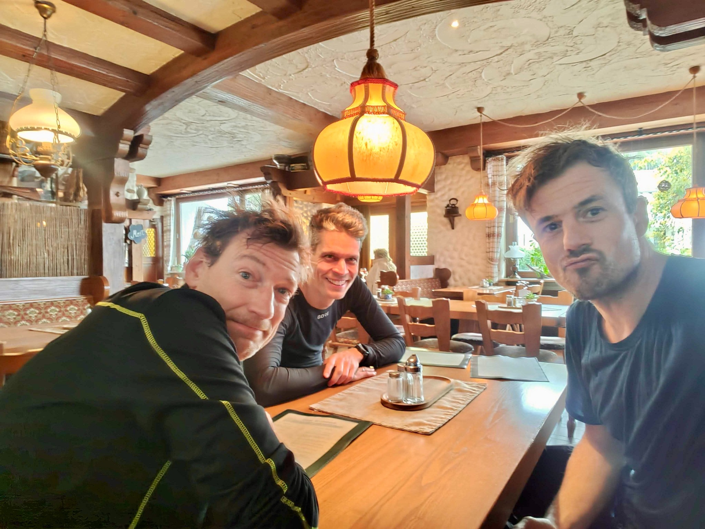
  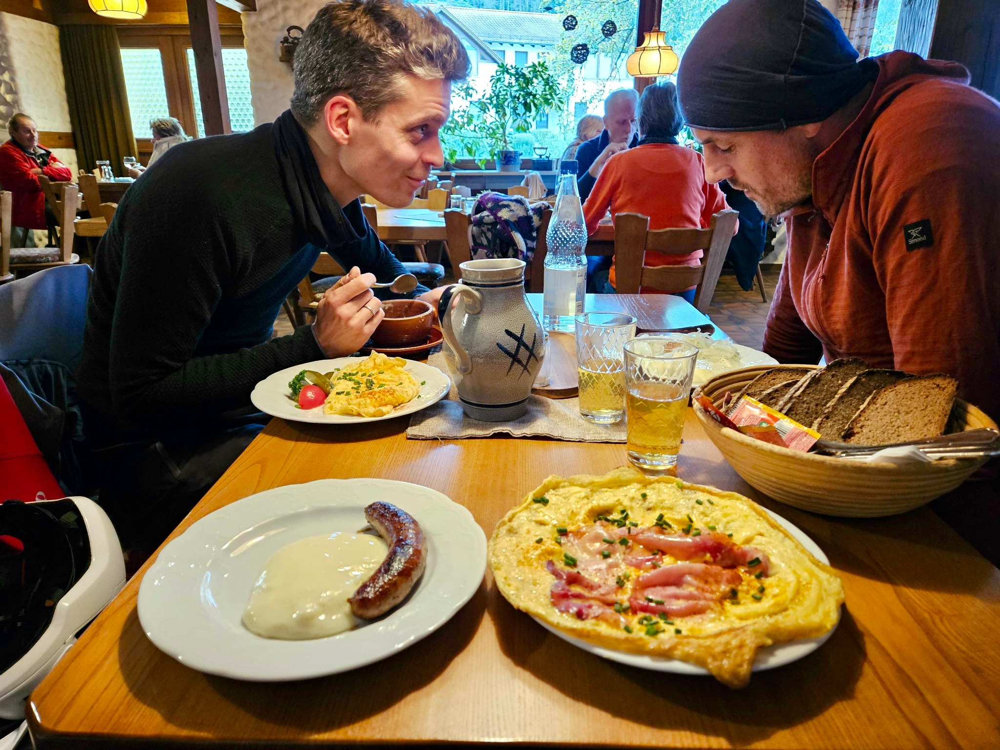

Nach anderthalb Stunden Kochkäs und reichlich gutem Essen wird es draußen langsam dunkel. Die Motivation, jetzt noch irgendwelche Trails zu fahren, geht gegen null. Also übernimmt die Vernunft. Oder besser: die Praktikanten-Lotsung. Auf möglichst direktem Weg geht’s über Straßen und Radwege Richtung Heppenheim. Die letzten 15 Kilometer fliegen nur so dahin. Vom Äppelwoi ist bei den Jungs spätestens am Bahnhof nicht mehr allzu viel zu merken.

Felix ist allerdings noch immer ein bisschen angezündet. Und vor allem durstig. Kurzerhand organisiert er in Bahnhofsnähe noch Reiseproviant. Bier für die Jungs, Wasser für mich. Das sorgt beim Verkaufspersonal offenbar für einige Verwirrung. Wer kauft denn freiwillig zum Mitnehmen?! Felix setzt sich durch. Verpflegung kann er einfach!

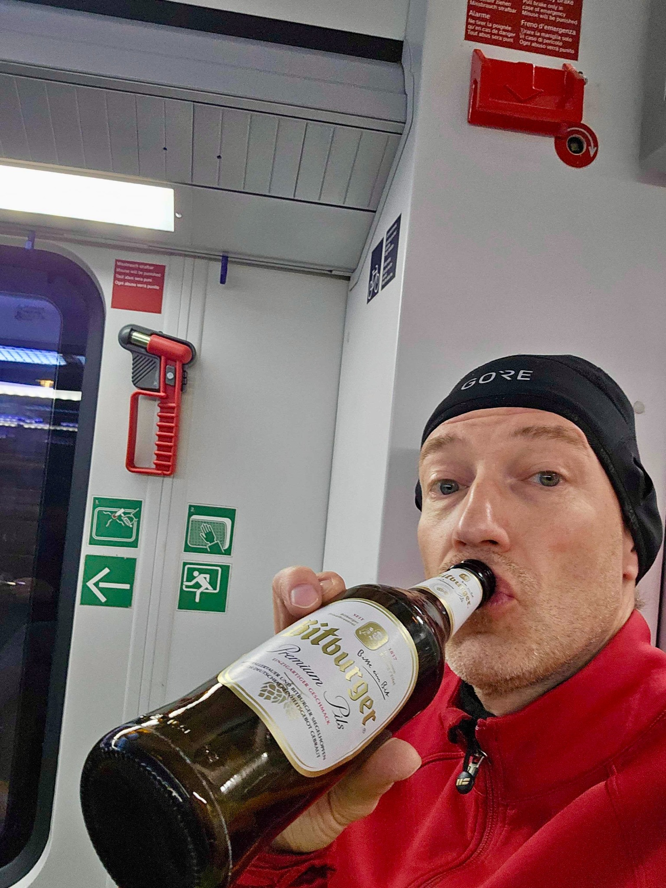

Im Zug zurück nach Heidelberg lassen wir den Tag ausklingen. 57 Kilometer, über 1.100 Höhenmeter, jede Menge Schlamm, überraschend geile Trails und endlich Kochkäs. Dass wir den Odenwald nördlich von Hirschhorn bisher so unterschätzt haben, war definitiv ein Fehler. Da müssen wir nochmal hin. Dann vielleicht mit etwas weniger Wasser im Boden.

Und der Kochkäs? Aller guten Dinge sind eben doch drei!

<iframe src="https://www.komoot.de/tour/3364170780/embed?share_token=aAyx5T5uS1LO45aIT1JiueX8oeqehThoUGpEf5s5l2LZTmbwt7" width="100%" height="600" frameborder="0" scrolling="no"></iframe>
